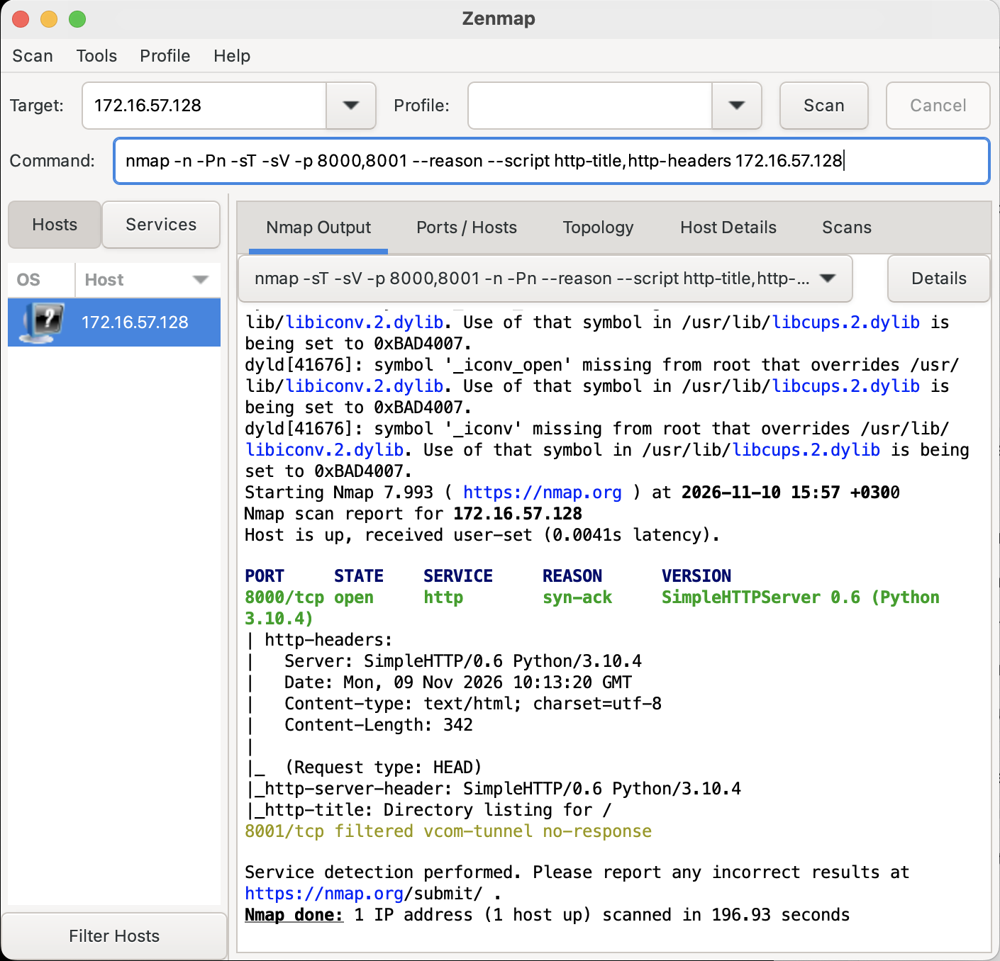
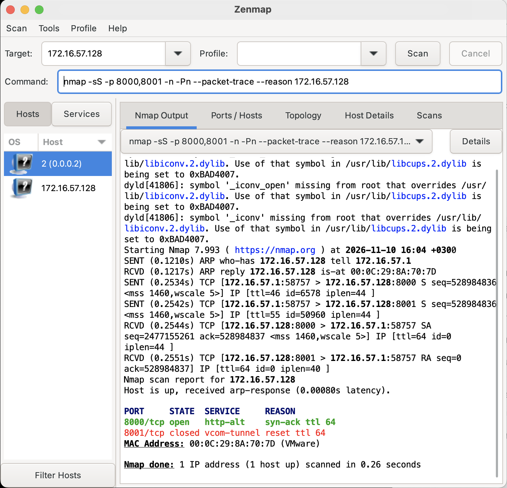
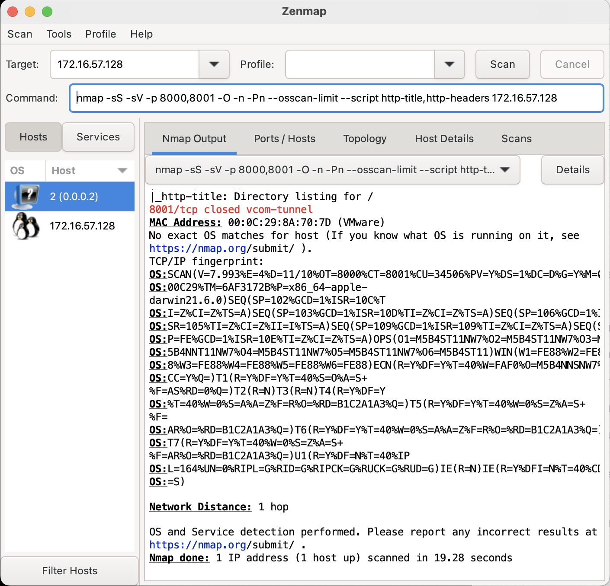
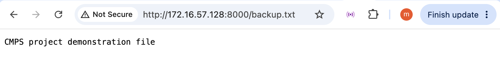
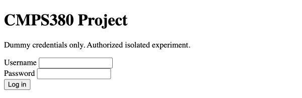
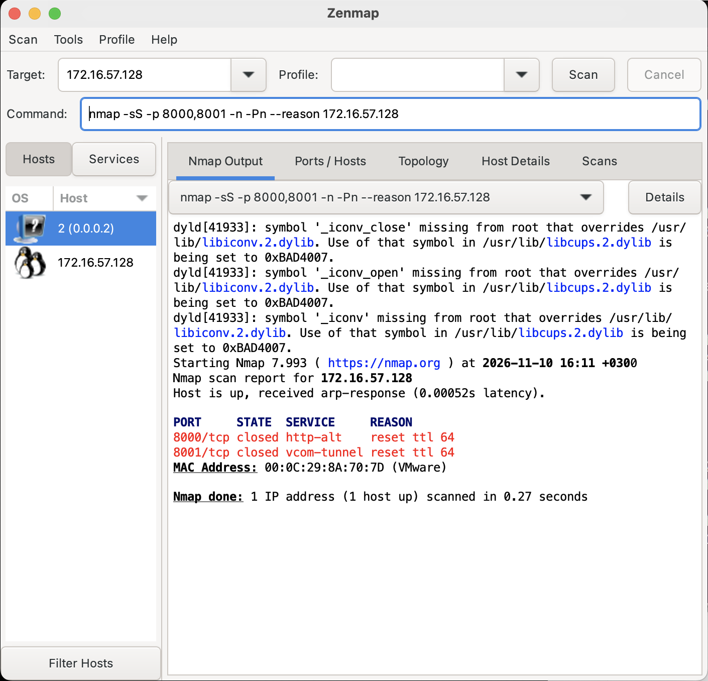

# Evidence and provenance

These are existing project results, not output from running the newly packaged scripts. Screenshots are genuine application captures cropped for the report.

## Mac Zenmap results

Mac Nmap 7.993 scanned Ubuntu at 172.16.57.128 on the VMware private network. The screenshot evidence below is the available record; the earlier Ubuntu XML files are not exports of these Mac scans.

### Figure 1. Zenmap connect assessment: port 8000 open, Python HTTP service and directory listing; port 8001 filtered. Completed in 196.93 s.

### Figure 2. Corrected Zenmap SYN scan: 8000 open (SYN/ACK), 8001 closed (reset), one target, 0.26 s. The old 0.0.0.2 sidebar entry is scan history.

### Figure 3. Zenmap OS assessment: no exact OS match; one hop; 19.28 s. The Linux icon does not identify an exact Ubuntu release.

### Figure 4. Browser retrieval of backup.txt confirms unauthenticated access to the harmless demonstration file.

### Figure 5. CMPS380 Project login page, recaptured locally at 127.0.0.1:8767 on 15 November 2026 after updating its title. This shows the current interface, not a new traffic-capture experiment.

### Figure 6. Successful Zenmap retest after stopping the server: both ports closed, reset replies with TTL 64, 0.27 s.

## Earlier Ubuntu experiments

`original-ubuntu-scans/` contains original Nmap 7.80 results for the separate 10.200.38.2 namespace target. `original-login-results/` contains the original 10.200.39.2 login comparison, including dummy-only packet captures. These must not be combined with Mac timings as a controlled performance comparison.

Historical files are preserved unchanged, including original titles and dummy credential strings. Current source uses CMPS380 Project and ProjectOnly-381. The login interface screenshot was recaptured on 15 November; it is not evidence of a new packet-capture run. Certificate/private-key files and personal report details are excluded.
